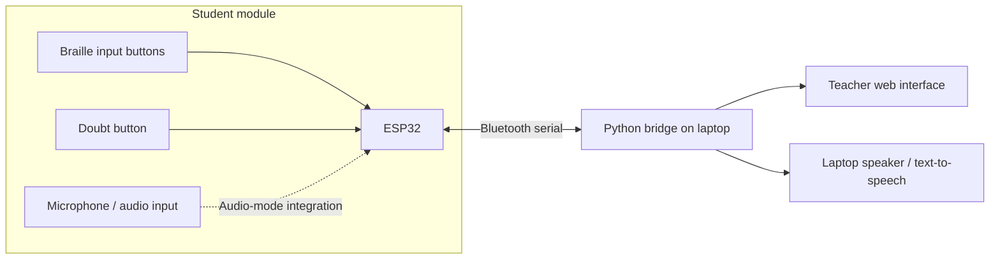

# PAALAM 🌉
### Bridging communication. Building inclusive classrooms.

**PAALAM** is a prototype assistive classroom communication system designed to make student–teacher interaction more accessible for learners with visual, hearing, or speech-related disabilities.

Instead of expecting every student to communicate in the same way, PAALAM explores **multiple ways to express, receive, and respond to information** through a connected student module and teacher module.

> **Our vision:** No student should be left unheard just because conventional classroom communication is inaccessible to them.

## 🎯 The problem

Classroom communication often depends on listening, speaking, reading a board, or raising a hand. These methods can create barriers:

- **Blind and low-vision students** may struggle with information presented only visually.
- **Deaf and hard-of-hearing students** may miss information delivered only through speech.
- **Students with speech-related disabilities** may need another way to ask questions or participate.
- **Teachers** may not have an immediate, accessible way to identify and respond to every student's needs.

PAALAM aims to reduce these gaps with an affordable, modular communication bridge.

## 💡 Our solution

PAALAM connects a **student-side assistive input device** to a **teacher-side interface**. The system is designed to support tactile input, text-based communication, speech-related features, and a dedicated way to signal doubts.

| Component | Purpose |
| --- | --- |
| **Student module** | Gives students accessible ways to enter messages and request help. |
| **Braille-based input** | Lets students compose text through tactile button input. |
| **Doubt button** | Sends an immediate help/request signal to the teacher. |
| **Teacher module** | Displays incoming messages and doubt requests on a laptop-based interface. |
| **Text-to-speech output** | Enables received text to be spoken through the laptop's speaker. |
| **ESP32 wireless link** | Connects hardware inputs and computer-based applications using Bluetooth serial communication in the prototype. |

## ✨ What makes PAALAM different?

**One classroom, multiple communication paths.** PAALAM combines assistive input, a teacher-facing view, and a direct doubt mechanism within a single prototype.

- **Accessibility-first:** Designed around different communication needs rather than a single interaction style.
- **Dedicated doubt button:** A student can request the teacher's attention without relying exclusively on speaking or hand-raising.
- **Modular architecture:** Hardware inputs and software interfaces can be developed and tested independently.
- **Demo-friendly design:** A laptop can act as the teacher display, so a separate physical display is not required for the prototype.
- **Expandable:** The architecture leaves room for future accessibility features and classroom-scale improvements.

## 🏗️ System architecture



**Prototype note:** The Bluetooth message exchange between the ESP32 and a laptop has been tested. Individual features, including microphone capture, end-to-end speech workflows, and teacher-side integration, are being developed and tested as part of the prototype.

## 🔌 Hardware

| Item | Role |
| --- | --- |
| ESP32 development board | Handles student-side inputs and Bluetooth communication. |
| Tactile push buttons | Form the Braille-style input mechanism. |
| Dedicated push button | Triggers a doubt/help request. |
| Microphone module | Supports the audio-input experiments. |
| Laptop | Runs the Python bridge, teacher display, and speaker output for the demo. |
| Second ESP32 *(optional for the demo)* | Can support a separate teacher-side hardware module as the system evolves. |

Actual pin assignments, wiring, and exact module models depend on the firmware version used in the repository.

## 🧰 Software and technologies

- **ESP32 firmware:** Microcontroller input handling and wireless communication.
- **Bluetooth serial:** Communication between the ESP32 and the laptop.
- **Python:** PC-side serial communication, message processing, and audio-related integration.
- **Web technologies:** Browser-based teacher interface.
- **Text-to-speech:** Spoken rendering of supported text messages using the laptop's audio output.

## Repository layout

- `Braillie_keyboard/braille_keyborad/braille_keyborad.ino`: ESP32 Braille keyboard, TFT display, Bluetooth and INMP441 microphone firmware.
- `Braillie_keyboard/libraries/`: bundled Arduino libraries and their upstream licenses. Keep the TFT_eSPI configuration aligned with your display and wiring.
- `speech/paalam_speech_server.py`: Windows Bluetooth serial bridge with text-to-speech and local Whisper speech recognition.
- `HandSigns/`: standalone experimental Indian Sign Language word recognizer, browser interface, fitted model, reference clips and tests. See [HandSigns setup and limitations](HandSigns/README.md), [model card](HandSigns/MODEL-CARD.md) and [test report](HandSigns/ISL-TEST-REPORT.md).

The HandSigns browser app runs independently of the ESP32 speech bridge. A unified teacher interface and dedicated doubt-request integration remain project goals.

## 🚀 Running the prototype

### HandSigns browser app

Install Node.js 20 or newer. From the repository root:

```powershell
cd HandSigns
node server.mjs
```

Open http://127.0.0.1:5173 in Chrome or Edge and allow camera access when you start the camera. On Windows, you can also double-click `HandSigns/Start HandSigns.cmd`. Runtime model and vendor assets are included; no Python setup is needed for normal HandSigns use. If MediaPipe assets are missing, run `node setup.mjs` from `HandSigns` with internet access. Optional model preparation has separate instructions in [training/README.md](HandSigns/training/README.md).

Run the existing recognition and composition tests from `HandSigns`:

```powershell
node --test tests/isl.test.mjs
```

### ESP32 firmware and Windows speech bridge

1. Install Arduino IDE with Espressif's ESP32 board support. Use an ESP32 board that supports Bluetooth Classic SPP; the firmware also uses `ESP_I2S.h`. Select a compatible board/core version and verify the sketch compiles for your hardware.
2. Open `Braillie_keyboard/braille_keyborad/braille_keyborad.ino`. Make the bundled libraries available to Arduino and review `TFT_eSPI` display configuration and all sketch pin assignments before connecting or uploading to hardware.
3. Pair the Bluetooth device named `PAALAM_ESP32` in Windows and identify its outgoing serial COM port.
4. Install Python and create a local virtual environment from the repository root:

```powershell
python -m venv .venv
.\.venv\Scripts\python.exe -m pip install pyserial numpy pyttsx3 faster-whisper
```

5. Change `PORT` in `speech/paalam_speech_server.py` to the assigned COM port (the current `COM12` is machine-specific). The script uses Windows SAPI5 speech output and the CPU `tiny.en` Whisper model; the first run may download model files.
6. Run the bridge:

```powershell
.\.venv\Scripts\python.exe speech\paalam_speech_server.py
```

Keep other serial monitors closed on the same port. Test text transfer before microphone capture. Hardware behavior requires physical validation; the automated HandSigns tests do not validate the ESP32 or Bluetooth connection.

### Source data, privacy and repository hygiene

HandSigns includes third-party runtime assets and reference recordings needed for the app to work. Preserve their attribution and licenses; the source datasets have research/academic and other usage restrictions documented in the [HandSigns README](HandSigns/README.md). This repository does not grant new rights to those materials.

Local environments, logs, caches, downloaded training data and prototype backups are excluded from new commits. Keep API keys, tokens, Wi-Fi credentials, private keys and personal recordings out of source files and Git history. Use local environment configuration when adding services that require secrets.

### Basic Bluetooth troubleshooting

- **`could not open port 'COMx'`:** Recheck the paired device's assigned outgoing COM port. It may change after reconnecting.
- **Connects but nothing arrives:** Verify the ESP32 firmware, Bluetooth pairing, port selection, and serial message format.
- **Microphone initialization fails:** Check available ESP32 RAM and I2S/DMA buffer settings; audio capture needs additional resources.
- **Text is received but not spoken:** Confirm that the PC text-to-speech component is running and the laptop audio output is enabled.

## 🎬 Demonstration flow

1. A student uses the Braille input or the **doubt button** on the student module.
2. The ESP32 sends a message to the connected laptop over Bluetooth.
3. The Python bridge processes the incoming message.
4. The teacher-facing interface is designed to show the student's message or doubt alert.
5. Where speech output is enabled, text can be read aloud through the laptop speaker.

The **doubt button** is a highlight of the demo: it turns a student's need for help into an explicit, visible request to the teacher.

## 📍 Development status

PAALAM is an **active prototype**, not a production-ready accessibility device.

| Area | Status |
| --- | --- |
| ESP32 ↔ laptop Bluetooth serial message exchange | **Tested** |
| Braille input workflow | **Prototype / integration** |
| Dedicated doubt-request workflow | **Prototype / integration** |
| Teacher laptop interface | **Under development** |
| Text-to-speech output | **Integration / testing** |
| ESP32 microphone/audio capture | **Experimental / debugging** |

## 🛣️ Roadmap

- [ ] Complete end-to-end student-to-teacher message delivery.
- [ ] Display distinct real-time doubt notifications in the teacher interface.
- [ ] Stabilize Braille text entry and message handling.
- [ ] Integrate and validate laptop-based text-to-speech.
- [ ] Optimize microphone capture and memory usage on the ESP32.
- [ ] Document final pin mappings, dependencies, and setup commands.
- [ ] Test usability with intended users and accessibility specialists.
- [ ] Explore support for multiple student devices in one classroom.

## 🤝 Contributing

Ideas, accessibility feedback, bug reports, and improvements are welcome. Please open an issue or propose a pull request. When contributing, keep the needs of students and teachers at the center of the design.

## ⚠️ Important note

PAALAM is a student-built prototype intended for demonstration and exploration. It should not be presented as a substitute for established assistive technologies or used as a student's sole accessibility support without appropriate testing and validation.

---

<p align="center"><strong>PAALAM 🌉</strong><br><em>Because every student deserves a way to be heard.</em></p>
