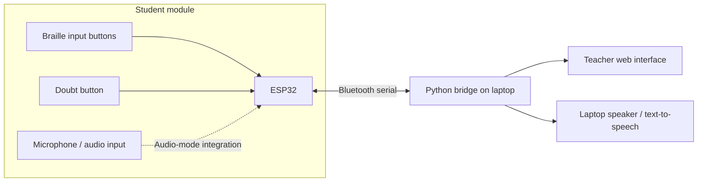

# PAALAM 🌉
### Bridging communication. Building inclusive classrooms.

**PAALAM** is a prototype assistive classroom communication system designed to make student–teacher interaction more accessible for learners with visual, hearing, or speech-related disabilities.

Instead of expecting every student to communicate in the same way, PAALAM explores **multiple ways to express, receive, and respond to information** through a connected student module and teacher module.

> **Our vision:** No student should be left unheard just because conventional classroom communication is inaccessible to them.

## 🎯 The problem

Classroom communication often depends on listening, speaking, reading a board, or raising a hand. These methods can create barriers:

- **Blind and low-vision students** may struggle with information presented only visually.
- **Deaf and hard-of-hearing students** may miss information delivered only through speech.
- **Students with speech-related disabilities** may need another way to ask questions or participate.
- **Teachers** may not have an immediate, accessible way to identify and respond to every student's needs.

PAALAM aims to reduce these gaps with an affordable, modular communication bridge.

## 💡 Our solution

PAALAM connects a **student-side assistive input device** to a **teacher-side interface**. The system is designed to support tactile input, text-based communication, speech-related features, and a dedicated way to signal doubts.

| Component | Purpose |
| --- | --- |
| **Student module** | Gives students accessible ways to enter messages and request help. |
| **Braille-based input** | Lets students compose text through tactile button input. |
| **Doubt button** | Sends an immediate help/request signal to the teacher. |
| **Teacher module** | Displays incoming messages and doubt requests on a laptop-based interface. |
| **Text-to-speech output** | Enables received text to be spoken through the laptop's speaker. |
| **ESP32 wireless link** | Connects hardware inputs and computer-based applications using Bluetooth serial communication in the prototype. |

## ✨ What makes PAALAM different?

**One classroom, multiple communication paths.** PAALAM combines assistive input, a teacher-facing view, and a direct doubt mechanism within a single prototype.

- **Accessibility-first:** Designed around different communication needs rather than a single interaction style.
- **Dedicated doubt button:** A student can request the teacher's attention without relying exclusively on speaking or hand-raising.
- **Modular architecture:** Hardware inputs and software interfaces can be developed and tested independently.
- **Demo-friendly design:** A laptop can act as the teacher display, so a separate physical display is not required for the prototype.
- **Expandable:** The architecture leaves room for future accessibility features and classroom-scale improvements.

## 🏗️ System architecture

**Prototype note:** The Bluetooth message exchange between the ESP32 and a laptop has been tested. Individual features, including microphone capture, end-to-end speech workflows, and teacher-side integration, are being developed and tested as part of the prototype.

## 🔌 Hardware

| Item | Role |
| --- | --- |
| ESP32 development board | Handles student-side inputs and Bluetooth communication. |
| Tactile push buttons | Form the Braille-style input mechanism. |
| Dedicated push button | Triggers a doubt/help request. |
| Microphone module | Supports the audio-input experiments. |
| Laptop | Runs the Python bridge, teacher display, and speaker output for the demo. |
| Second ESP32 *(optional for the demo)* | Can support a separate teacher-side hardware module as the system evolves. |

Actual pin assignments, wiring, and exact module models depend on the firmware version used in the repository.

## 🧰 Software and technologies

- **ESP32 firmware:** Microcontroller input handling and wireless communication.
- **Bluetooth serial:** Communication between the ESP32 and the laptop.
- **Python:** PC-side serial communication, message processing, and audio-related integration.
- **Web technologies:** Browser-based teacher interface.
- **Text-to-speech:** Spoken rendering of supported text messages using the laptop's audio output.

## 🚀 Running the prototype

> This is a hardware-plus-software project. The exact filenames and dependencies may differ between prototype revisions; use the source files included with your version.

1. **Prepare the ESP32.** Connect it by USB, open the student-module firmware in your ESP32-compatible development environment, select the correct board and serial port, and upload it.
2. **Pair the device.** In Windows Bluetooth settings, pair the ESP32 device and identify the outgoing Bluetooth serial **COM port** in Device Manager.
3. **Configure the Python bridge.** Set the Bluetooth COM port in the Python application to match the port Windows assigned (for example, `COM11` is only an example, not a fixed port).
4. **Install Python dependencies.** Use the project's dependency file if one is included; otherwise install the libraries imported by the Python application.
5. **Start the PC application.** Run the Python bridge, then launch the teacher interface using the instructions provided with its source code.
6. **Test communication.** Send a simple message and confirm that it is received on the other side before testing Braille input, doubt notifications, or speech features.

### Basic Bluetooth troubleshooting

- **`could not open port 'COMx'`:** Recheck the paired device's assigned outgoing COM port. It may change after reconnecting.
- **Connects but nothing arrives:** Verify the ESP32 firmware, Bluetooth pairing, port selection, and serial message format.
- **Microphone initialization fails:** Check available ESP32 RAM and I2S/DMA buffer settings; audio capture needs additional resources.
- **Text is received but not spoken:** Confirm that the PC text-to-speech component is running and the laptop audio output is enabled.

## 🎬 Demonstration flow

1. A student uses the Braille input or the **doubt button** on the student module.
2. The ESP32 sends a message to the connected laptop over Bluetooth.
3. The Python bridge processes the incoming message.
4. The teacher-facing interface is designed to show the student's message or doubt alert.
5. Where speech output is enabled, text can be read aloud through the laptop speaker.

The **doubt button** is a highlight of the demo: it turns a student's need for help into an explicit, visible request to the teacher.

## 📍 Development status

PAALAM is an **active prototype**, not a production-ready accessibility device.

| Area | Status |
| --- | --- |
| ESP32 ↔ laptop Bluetooth serial message exchange | **Tested** |
| Braille input workflow | **Prototype / integration** |
| Dedicated doubt-request workflow | **Prototype / integration** |
| Teacher laptop interface | **Under development** |
| Text-to-speech output | **Integration / testing** |
| ESP32 microphone/audio capture | **Experimental / debugging** |

## 🛣️ Roadmap

- [ ] Complete end-to-end student-to-teacher message delivery.
- [ ] Display distinct real-time doubt notifications in the teacher interface.
- [ ] Stabilize Braille text entry and message handling.
- [ ] Integrate and validate laptop-based text-to-speech.
- [ ] Optimize microphone capture and memory usage on the ESP32.
- [ ] Document final pin mappings, dependencies, and setup commands.
- [ ] Test usability with intended users and accessibility specialists.
- [ ] Explore support for multiple student devices in one classroom.

## 🤝 Contributing

Ideas, accessibility feedback, bug reports, and improvements are welcome. Please open an issue or propose a pull request. When contributing, keep the needs of students and teachers at the center of the design.

## ⚠️ Important note

PAALAM is a student-built prototype intended for demonstration and exploration. It should not be presented as a substitute for established assistive technologies or used as a student's sole accessibility support without appropriate testing and validation.

---

<strong>PAALAM 🌉</strong> <em>Because every student deserves a way to be heard.</em>

